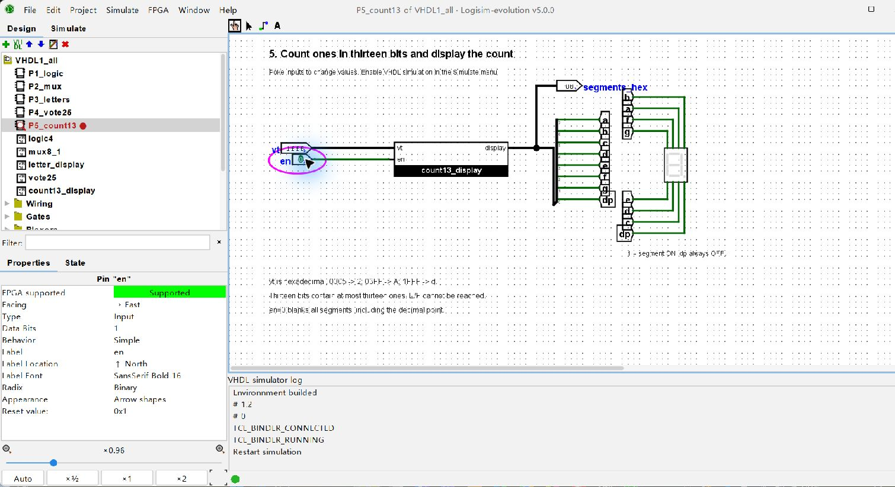

VHDL 과제

1. AND / OR 회로

a, b, c, d를 입력으로 사용했다. AND는 네 입력이 모두 1일 때만 1이고, OR는 하나 이상이 1이면 1이다.

```vhdl
out1 <= a and b and c and d;
out2 <= a or b or c or d;
```

입력을 모두 1로 했을 때 out1과 out2가 모두 1이 나왔다.


검증: 입력 0000에서는 두 출력이 0, 입력 1110에서는 out1=0, out2=1, 입력 1111에서는 두 출력이 1이다.

2. 8-to-1 Multiplexer

입력 a~h 중에서 ch가 지정하는 한 개를 data로 출력한다. 8개를 구분해야 하므로 선택 신호 ch는 3비트로 했다.

ch=000, 001, 010, 011, 100, 101, 110, 111 순서로 a, b, c, d, e, f, g, h를 선택한다.

e만 1로 두고 ch=100을 넣었을 때 e가 선택되어 data=1이 나왔다.


선택 신호의 값이 출력값이 되는 것은 아니다. 선택된 입력이 0이면 출력도 0이고, 선택된 입력이 1이면 출력도 1이다.

3. 7세그먼트 문자 표시

문자 a, b, c, d, f, g에 맞게 막대를 켜도록 했다. 7세그먼트에서 표현할 수 있는 모양인 A, b, C, d, F, G를 사용했다.

dat=000, 001, 010, 011, 100, 101을 각각 A, b, C, d, F, G에 대응시켰다. 사용하지 않는 110, 111과 en=0에서는 표시를 끈다.

display(7 downto 0)는 a, b, c, d, e, f, g, dp 순서이며 1에서 켜진다. 출력 8비트를 Splitter로 나누어 표시기의 각 막대에 연결했다.

en=1, dat=000일 때 A가 표시됐다. a, b, c, e, f, g가 켜지고 d와 dp는 꺼진다.


4. 25인 투표기

vt의 25개 비트를 각각 한 사람의 표로 사용했다. 1은 찬성, 0은 반대이다. 1의 개수를 세고 13개 이상이면 result=1을 출력한다.

25명의 절반은 12.5명이므로 과반수는 13명부터이다. 합계는 매번 0으로 초기화하고, 모든 비트를 센 뒤 결과를 정했다.

vt=0001FFF(16진수)에는 1이 13개 있으므로 result=1이 나왔다.


경계값 검증: vt=0000FFF는 찬성 12개로 result=0, vt=0001FFF는 찬성 13개로 result=1이다. 전체가 1이었다가 0으로 바뀌는 경우도 검사했다.

5. 13비트의 1 개수 표시

vt 안의 1을 세고 그 개수를 7세그먼트에 표시했다. 예를 들어 vt=0005(16진수)는 1이 두 개이므로 5가 아니라 2를 표시한다. en=0이면 모든 막대를 끈다.

문제에는 14개일 때 E, 15개일 때 F도 요구하지만 13비트에는 1이 최대 13개만 들어간다. 따라서 E/F 패턴은 코드에 넣되 실제 표시 범위는 0~13이다.

vt=1FFF, en=1: 1이 13개이므로 d가 표시됐다.


같은 입력에서 en=0으로 바꾸면 표시가 꺼진다.


