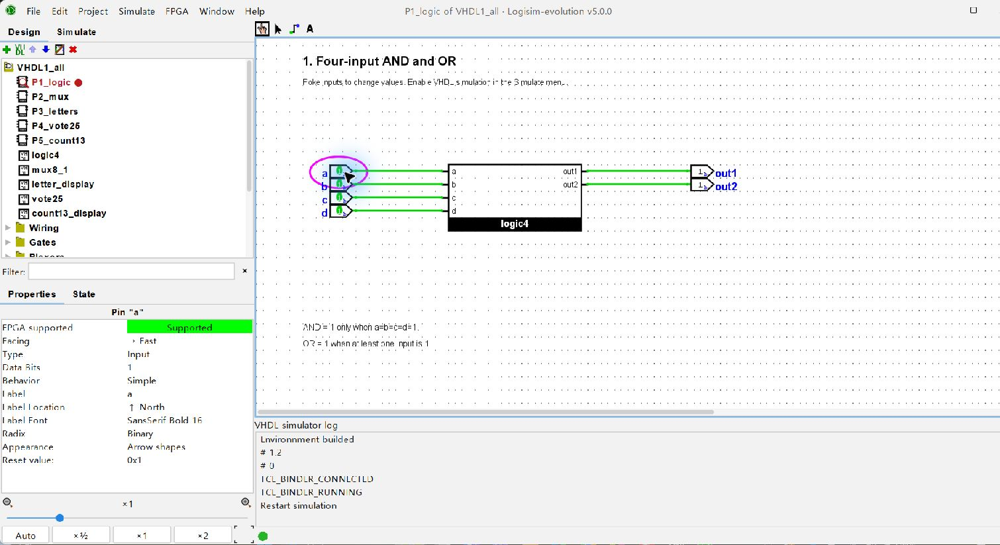
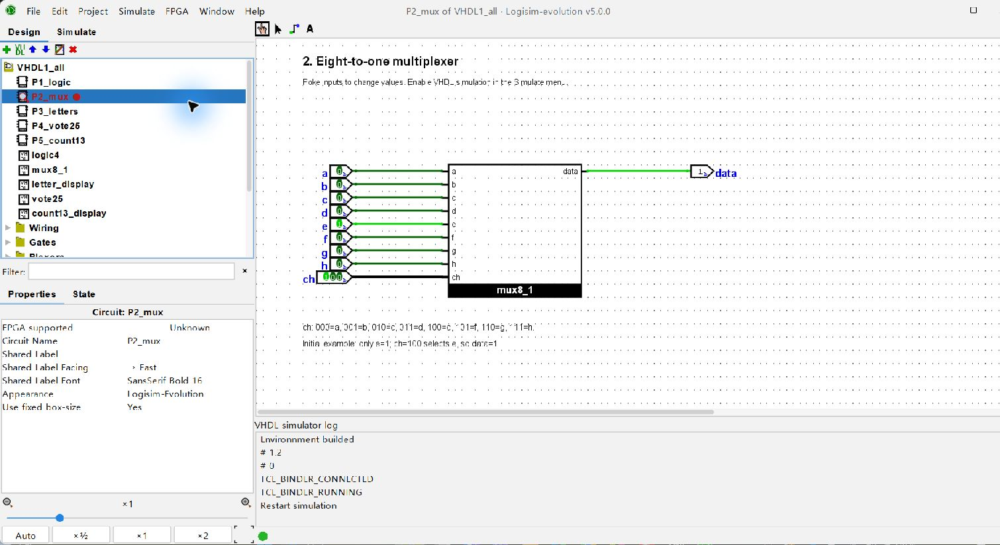
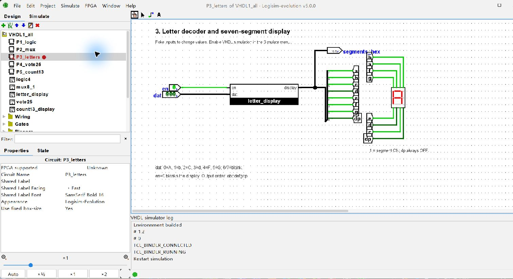
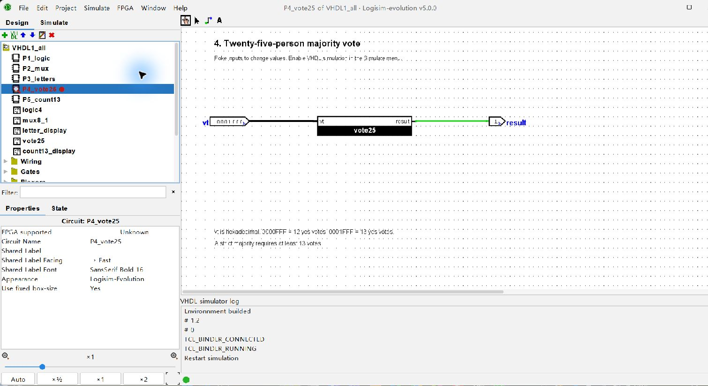
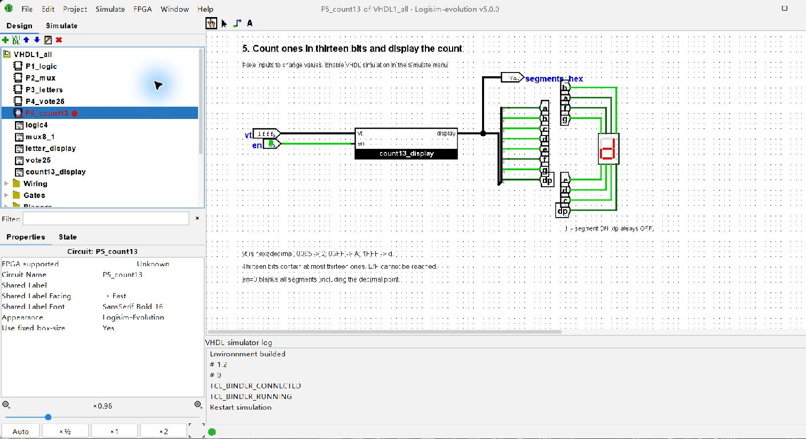

VHDL 조합회로 설계
및 Logisim 검증 보고서

Digital Logic Circuit Design | VHDL 1 | 과제 1-5

작성일: 2026년 10월 29일

강의자료 마지막 페이지의 5개 문제를 VHDL로 구현하고, Logisim-evolution의 VHDL 블록에 입력 핀과 출력 표시기를 연결하였다. 설치된 Questa에서 자동 검증을 수행하고 실제 회로 화면의 출력도 확인하였다.

### 설계 범위

| 문제 | 구현 내용 | 핵심 조건 |
| --- | --- | --- |
| 1 | 4입력 AND / OR | 모든 입력이 1 / 하나 이상의 입력이 1 |
| 2 | 8:1 멀티플렉서 | 3비트 선택 신호로 8개 중 하나 선택 |
| 3 | 문자 표시 디코더 | A, b, C, d, F, G 점등 |
| 4 | 25인 투표기 | 찬성 13표 이상이면 통과 |
| 5 | 13비트의 1 개수 표시 | en=0 소등, en=1 개수 표시 |

### 공통 설계 기준

다섯 설계는 현재 입력으로 출력이 결정되는 조합회로이다. 클록과 리셋 입력을 사용하지 않는다. IEEE std_logic_1164의 신호형을 사용하며, 합계를 계산하는 process에서는 변수를 0으로 초기화한 뒤 :=로 누적한다.

7세그먼트는 display(7 downto 0)=a,b,c,d,e,f,g,dp 순서이며 1에서 켜진다. 소수점은 항상 0이다. 표시기의 en=0은 고임피던스 대신 00000000을 출력해 소등을 명확히 정의하였다.

### 검증 환경과 요약

Logisim-evolution 5.0.0, Questa Altera Starter FPGA Edition 2025.2(설치 패키지 25.1), VHDL-2002 환경을 사용하였다. 23,213개 자동 테스트가 통과하였다. 회로 파일 내부에 포함된 VHDL과 별도 src 파일의 일치 여부도 검사하였다.

**요구사항 해석:** 5번은 13비트에서 만들 수 없는 14개, 15개의 1에 대해서도 E/F 표시를 요구한다. 입력 폭은 13비트로 유지하고 E/F 패턴은 표시 표에 포함하되, 실제 도달 범위가 0-13임을 구분하였다.

문제 출처: 제공된 VHDL_1 (1).pdf 22쪽. 표시기 비트 순서와 점등 기준은 같은 자료 17-18쪽을 따른다.

## 1. 4입력 AND와 OR

**문제:** a,b,c,d를 입력으로 받아 out1은 네 입력의 AND, out2는 네 입력의 OR를 출력한다.

**원리:** AND는 모든 입력이 1일 때만 1이다. OR는 하나 이상의 입력이 1이면 1이다. 두 신호 할당문은 동시에 동작하는 두 조합회로를 기술한다.

| a b c d | out1 | out2 |
| --- | --- | --- |
| 0 0 0 0 | 0 | 0 |
| 0 1 0 0 | 0 | 1 |
| 1 1 1 0 | 0 | 1 |
| 1 1 1 1 | 1 | 1 |

그림 1. 모든 입력이 1일 때 AND와 OR가 모두 1인 실제 Logisim 화면.



**구현:** logic4 블록에 1비트 입력 핀 4개와 출력 핀 2개를 연결하였다. out1 &lt;= a and b and c and d; 및 out2 &lt;= a or b or c or d;의 동시 할당을 사용한다.

**검증:** 4비트 입력의 모든 16개 조합을 검사하였다. AND는 1111에서만 1, OR는 0000에서만 0인 것을 확인하였다.

## 2. 8:1 멀티플렉서

**문제:** 8개의 1비트 입력 a-h 중 하나를 선택하여 data로 보낸다. 8개 선택지를 구분하기 위해 3비트 ch가 필요하다.

| ch | 선택 입력 |
| --- | --- |
| 000 | a |
| 001 | b |
| 010 | c |
| 011 | d |
| 100 | e |
| 101 | f |
| 110 | g |
| 111 | h |

**원리:** ch는 출력값이 아니라 선택 주소이다. 예를 들어 ch=100은 e를 선택하므로 e=0이면 data=0, e=1이면 data=1이다. with ch select로 선택 표를 구현하였다.

그림 2. e만 1인 입력에서 ch=100을 선택하여 data=1이 되는 화면.



**검증:** 8개 입력의 256가지 조합과 선택 신호 8가지를 조합한 2,048개 테스트를 수행하였다. 모든 선택에서 data가 해당 입력과 같은지 확인하였다.

## 3. 문자 7세그먼트 디코더

**문제:** 문자 a,b,c,d,f,g를 7세그먼트로 표시한다. 막대의 표현 한계를 고려하여 A,b,C,d,F,G 모양을 사용하였다. 선택 코드가 지정되어 있지 않아 dat 3비트를 아래와 같이 정하였다. en은 강의의 표시기 예제와 같이 추가하였다.

| dat | 문자 | 켜는 막대 | abcdefgdp |
| --- | --- | --- | --- |
| 000 | A | a b c e f g | 11101110 |
| 001 | b | c d e f g | 00111110 |
| 010 | C | a d e f | 10011100 |
| 011 | d | b c d e g | 01111010 |
| 100 | F | a e f g | 10001110 |
| 101 | G | a c d e f | 10111100 |

**원리:** 문자에 해당하는 막대 패턴을 case 문으로 선택한다. en=0 또는 미사용 코드 110/111이면 모든 막대를 끈다. 기본 출력을 먼저 할당하여 출력이 정의되지 않는 경로를 없앴다.

그림 3. dat=000, en=1에서 A를 표시하는 실제 회로. Splitter와 Tunnel로 막대를 연결하였다.



**검증:** 선택 코드 8가지와 en 2가지를 조합한 16개 조건을 검사하였다. 문자열 패턴과 별도로 켜져야 할 막대 이름을 사용한 기준값과 비교하였다.

## 4. 25인 과반수 투표기

**문제:** vt(25 downto 1)의 각 비트는 한 사람의 찬반이다. 1을 찬성으로 해석하고 과반수가 찬성하면 result=1을 출력한다.

**원리:** 25/2=12.5이므로 과반수의 최소 정수는 13이다. 각 비트가 1일 때 sum을 증가시킨 뒤 sum &gt;= 13을 판정한다. sum은 매 입력 변화마다 0으로 초기화한다.

출력 판정은 반복문을 마친 뒤 수행한다. 따라서 입력이 전부 0인 경우에도 result=0이 명확히 할당되며, 이전 출력이 남는 래치 동작을 피한다. for 문은 클록 25번을 기다리는 절차가 아니라 비트 합산 회로를 기술한다.

그림 4. vt=0001FFF(16진수)는 13개의 1을 포함하므로 result=1이다.



| vt: 16진수 | 찬성 수 | 기대 결과 |
| --- | --- | --- |
| 0000000 | 0 | 0 |
| 0000FFF | 12 | 0 |
| 0001FFF | 13 | 1 |
| 1FFFFFF | 25 | 1 |

**검증:** 찬성 수 0-25별로 입력 위치를 순환하는 650개 패턴, 의사난수 4,096개 패턴, 전원 찬성에서 전원 반대로 바꾸는 2개 조건을 검사하였다. 총 4,748건이며 25비트 전체 패턴을 전수 검사한 것은 아니다.

## 5. 13비트의 1 개수와 표시 제어

**문제:** vt(13 downto 1) 안의 1 개수를 세어 한 자리 16진수 문자로 표시한다. en=0이면 소등하고 en=1이면 계산한 개수를 표시한다.

**원리:** 1의 개수를 구하는 회로와 7세그먼트 디코더를 연결한다. 입력의 이진수 값 자체를 표시하는 것이 아니다. 예를 들어 vt=0000000000101의 이진수 값은 5이지만, 1은 두 개이므로 2를 표시한다.

| en | vt: 16진수 | 1 개수 | 표시 |
| --- | --- | --- | --- |
| 1 | 0000 | 0 | 0 |
| 1 | 0005 | 2 | 2 |
| 1 | 01FF | 9 | 9 |
| 1 | 03FF | 10 | A |
| 1 | 07FF | 11 | b |
| 1 | 0FFF | 12 | C |
| 1 | 1FFF | 13 | d |
| 0 | 1FFF | 13 | 소등 |

그림 5. vt=1FFF의 13개 입력이 모두 1이므로 d를 표시한다. 출력 패턴은 7A이다.



**검증:** 13비트 입력 8,192가지와 en 2가지를 모두 검사하고 마지막 소등 전환 1개를 추가하였다. 총 16,385건을 통과하였다. en=0은 숫자 0 표시가 아니라 모든 막대가 꺼지는 상태이다.

## 요구사항의 모순과 검증 결과

### 왜 14개와 15개는 불가능한가

13비트는 13개의 입력 자리를 뜻한다. 각 자리에는 1이 최대 한 개 있으므로 1의 개수는 0 이상 13 이하이다. 모든 자리가 1인 1111111111111이 이미 최댓값 13이다. 따라서 14개와 15개의 1을 갖는 13비트 입력은 존재하지 않는다.

문제는 1의 개수가 14이면 E, 15이면 F를 표시하라고도 요구한다. 이는 입력 폭을 13비트로 고정한 조건과 실제로 가능한 개수의 범위가 맞지 않는다는 의미이다. 13비트로 8,192개 정수 값을 표현할 수 있어도, 각 패턴에 포함된 1의 개수는 여전히 최대 13개이다.

본 구현은 13비트 입력 조건을 유지하고, E/F 패턴을 표시 표에 포함하였다. 다만 E/F 분기는 도달 불가능하다. sum의 선언 범위를 0-15로 늘린 것은 표시 표를 기술하기 위한 것으로, 실제 입력에 1을 추가하지 않는다.

**일관된 수정안:** 입력 13비트를 유지하면 표시 범위를 0-13으로 정한다. 0-15의 모든 개수를 실제로 표시하려면 입력을 최소 15비트로 늘린다. 4비트 정수가 0-15를 나타낼 수 있다는 사실은 별개이며, 4비트의 1 개수는 최대 4개이다.

### 자동 검증 범위

| 문제 | 검증 범위 | 개수 |
| --- | --- | --- |
| 1 | 4비트 입력 전체 | 16 |
| 2 | 입력 256 x 선택 8 | 2,048 |
| 3 | 선택 8 x en 2 | 16 |
| 4 | 찬성 수/위치/의사난수/전환 | 4,748 |
| 5 | 입력 8,192 x en 2 + 소등 전환 | 16,385 |
| 합계 | 모든 조건 통과 | 23,213 |

별도 tests/questa.log에는 실제 컴파일 및 실행 로그가 있고, tests/results.json에는 문제별 검사 개수와 결과가 있다. 실제 FPGA 보드의 핀 배치, 배치·배선, 전기적 특성은 본 과제의 검증 범위에 포함하지 않았다. 실제 동작 화면과 자동 테스트의 범위를 구분하여 기록하였다.

### 재현 및 실행

circuits/VHDL1_all.circ 또는 개별 회로를 열고 VHDL Simulation Enabled를 켠다. 전체 프로젝트에서 다른 문제로 이동한 경우 Restart VHDL simulator를 실행하여 현재 회로로 다시 구성한다. 신호가 아직 반영되지 않으면 Active 상태에서 Reset Simulation을 실행한다. 독립 자동 테스트는 Logisim의 VHDL 시뮬레이션을 끈 뒤 tools/verify_questa.py로 실행한다.

참고: Logisim 공식 VHDL 연동 설명과 제공된 강의자료를 사용하였다. src의 다섯 코드 파일과 회로 안에 내장된 코드가 일치함을 검사했다.

## 부록 1. 01_logic4.vhd

아래 코드는 해당 Logisim VHDL 블록 안에 포함된 내용과 동일하다.

```vhdl
library ieee;
use ieee.std_logic_1164.all;

-- Problem 1: four-input AND and OR gates.
entity logic4 is
    port (
        a, b, c, d : in  std_logic;
        out1       : out std_logic;
        out2       : out std_logic
    );
end entity logic4;

architecture rtl of logic4 is
begin
    out1 <= a and b and c and d;
    out2 <= a or b or c or d;
end architecture rtl;
```

## 부록 2. 02_mux8_1.vhd

아래 코드는 해당 Logisim VHDL 블록 안에 포함된 내용과 동일하다.

```vhdl
library ieee;
use ieee.std_logic_1164.all;

-- Problem 2: ch=000 selects a, ..., ch=111 selects h.
entity mux8_1 is
    port (
        a, b, c, d, e, f, g, h : in  std_logic;
        ch                      : in  std_logic_vector(2 downto 0);
        data                    : out std_logic
    );
end entity mux8_1;

architecture rtl of mux8_1 is
begin
    with ch select
        data <= a   when "000",
                b   when "001",
                c   when "010",
                d   when "011",
                e   when "100",
                f   when "101",
                g   when "110",
                h   when "111",
                '0' when others;
end architecture rtl;
```

## 부록 3. 03_letter_display.vhd

아래 코드는 해당 Logisim VHDL 블록 안에 포함된 내용과 동일하다.

```vhdl
library ieee;
use ieee.std_logic_1164.all;

-- Problem 3: display the letters a, b, c, d, f, g.
-- Seven-segment approximations: A, b, C, d, F, G.
-- display(7 downto 0) = a b c d e f g dp; 1 = segment on.
-- dat: 000=A, 001=b, 010=C, 011=d, 100=F, 101=G.
entity letter_display is
    port (
        en      : in  std_logic;
        dat     : in  std_logic_vector(2 downto 0);
        display : out std_logic_vector(7 downto 0)
    );
end entity letter_display;

architecture rtl of letter_display is
begin
    process(en, dat)
    begin
        display <= "00000000";
        if en = '1' then
            case dat is
                when "000" => display <= "11101110"; -- A
                when "001" => display <= "00111110"; -- b
                when "010" => display <= "10011100"; -- C
                when "011" => display <= "01111010"; -- d
                when "100" => display <= "10001110"; -- F
                when "101" => display <= "10111100"; -- G
                when others => display <= "00000000";
            end case;
        end if;
    end process;
end architecture rtl;
```

## 부록 4. 04_vote25.vhd

아래 코드는 해당 Logisim VHDL 블록 안에 포함된 내용과 동일하다.

```vhdl
library ieee;
use ieee.std_logic_1164.all;

-- Problem 4: a strict majority of 25 voters requires at least 13 votes.
entity vote25 is
    port (
        vt     : in  std_logic_vector(25 downto 1);
        result : out std_logic
    );
end entity vote25;

architecture rtl of vote25 is
begin
    process(vt)
        variable sum : integer range 0 to 25;
    begin
        sum := 0;
        for i in vt'range loop
            if vt(i) = '1' then
                sum := sum + 1;
            end if;
        end loop;

        if sum >= 13 then
            result <= '1';
        else
            result <= '0';
        end if;
    end process;
end architecture rtl;
```

## 부록 5. 05_count13_display.vhd

아래 코드는 해당 Logisim VHDL 블록 안에 포함된 내용과 동일하다.

```vhdl
library ieee;
use ieee.std_logic_1164.all;

-- Problem 5: count the ones in vt and display the hexadecimal count.
-- display(7 downto 0) = a b c d e f g dp; 1 = segment on.
-- A 13-bit input can produce only 0..13; E/F entries are unreachable.
entity count13_display is
    port (
        vt      : in  std_logic_vector(13 downto 1);
        en      : in  std_logic;
        display : out std_logic_vector(7 downto 0)
    );
end entity count13_display;

architecture rtl of count13_display is
begin
    process(vt, en)
        variable sum : integer range 0 to 15;
    begin
        sum := 0;
        for i in vt'range loop
            if vt(i) = '1' then
                sum := sum + 1;
            end if;
        end loop;

        display <= "00000000";
        if en = '1' then
            case sum is
                when  0 => display <= "11111100";
                when  1 => display <= "01100000";
                when  2 => display <= "11011010";
                when  3 => display <= "11110010";
                when  4 => display <= "01100110";
                when  5 => display <= "10110110";
                when  6 => display <= "10111110";
                when  7 => display <= "11100000";
                when  8 => display <= "11111110";
                when  9 => display <= "11110110";
                when 10 => display <= "11101110"; -- A
                when 11 => display <= "00111110"; -- b
                when 12 => display <= "10011100"; -- C
                when 13 => display <= "01111010"; -- d
                when 14 => display <= "10011110"; -- E
                when 15 => display <= "10001110"; -- F
                when others => display <= "00000000";
            end case;
        end if;
    end process;
end architecture rtl;
```
